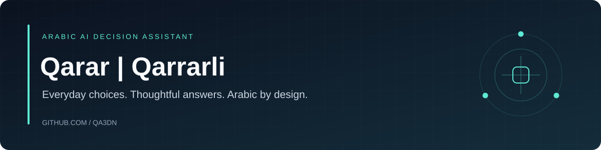

## Project overview

An Arabic AI-assisted decision-making application with playful everyday choices and a more analytical mode. The project includes account authentication, user profiles, and decision history.

**Stack:** JavaScript · HTML/CSS · Node.js · Express · MongoDB · OpenRouter.

The repository keeps its existing MIT license. Follow the original Arabic setup guide below and provide your own environment configuration and provider credentials.

---

# 🎲 قررلي - موقع القرارات الذكي

## 📋 الوصف
موقع عربي ذكي لاتخاذ القرارات باستخدام الذكاء الاصطناعي. يساعدك في اتخاذ قراراتك اليومية والجدية بطريقة ممتعة وذكية.

## ✨ المميزات
- **قرارات فكاهية** - قرارات سريعة وممتعة للقرارات اليومية
- **قرارات جدية** - تحليل مفصل للقرارات المهمة
- **نظام مستخدمين** - تسجيل دخول وحفظ التاريخ
- **تصميم فضاء** - واجهة جميلة مع تأثيرات بصرية
- **دعم عربي كامل** - جميع النصوص والتفاعلات بالعربية

## 🏗️ هيكل المشروع
```
qarar/
├── frontend/         # Frontend (الواجهة الأمامية)
│   ├── public/       # ملفات الموقع
│   │   ├── index.html    # الصفحة الرئيسية
│   │   ├── premium.html  # صفحة القرارات الجدية
│   │   ├── profile.html  # صفحة الملف الشخصي
│   │   ├── login.html    # صفحة تسجيل الدخول
│   │   ├── styles.css    # ملف التنسيقات
│   │   └── script.js     # ملف الجافا سكريبت
│   ├── package.json  # تبعيات Frontend
│   └── start.bat     # تشغيل Frontend
├── backend/          # Backend (الخادم)
│   ├── server.js     # الخادم الرئيسي
│   ├── models/       # نماذج قاعدة البيانات
│   ├── routes/       # مسارات API
│   ├── middleware/   # الوسطاء
│   ├── package.json  # تبعيات Backend
│   └── start.bat     # تشغيل Backend
├── package.json      # تبعيات المشروع الرئيسي
├── start.bat         # تشغيل المشروع
└── README.md         # هذا الملف
```

## 🚀 التثبيت والتشغيل

### تشغيل سريع
```bash
# تشغيل الملف الرئيسي
start.bat
# أو
npm run start:frontend  # Frontend فقط
npm run start:backend   # Backend فقط
```

### تثبيت جميع التبعيات
```bash
# تثبيت تبعيات المشروع الرئيسي
npm install

# تثبيت تبعيات Frontend و Backend
npm run install:all
```

### تشغيل منفصل

#### Frontend (الواجهة الأمامية)
```bash
cd frontend
npm install
npm start
# أو
start.bat
```

#### Backend (الخادم)
```bash
cd backend
npm install
npm start
# أو
start.bat
```

## 🔧 المتطلبات
- **Node.js** 16+ 
- **MongoDB** (محلي أو سحابي)
- **OpenRouter API Key** (للذكاء الاصطناعي)

## 📡 API Endpoints
- `POST /api/ask` - سؤال عادي (فكاهي)
- `POST /api/serious-ask` - سؤال جدي (تحليلي)
- `POST /api/register` - تسجيل حساب جديد
- `POST /api/login` - تسجيل الدخول
- `GET /api/profile` - جلب بيانات الملف الشخصي

## 🎨 التصميم
- **خلفية فضاء** مع نجوم متحركة
- **ألوان ذهبية وزرقاء** أنيقة
- **تأثيرات بصرية** متطورة
- **تصميم متجاوب** لجميع الأجهزة

## 📝 الترخيص
MIT License - يمكن استخدام المشروع بحرية

## 👥 فريق العمل
Qarar Team - فريق قررلي

---
**استمتع باتخاذ قراراتك مع قررلي! 🎲✨**